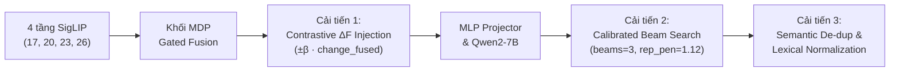

# Bộ Slide Báo Cáo: Cải Tiến Thuật Toán M³Diff trên Benchmark OmniDiff (ICCV 2025)

---

````carousel
## Slide 1: Tổng quan Bài toán & Động lực Nghiên cứu

### Bài toán Image Difference Captioning (IDC) trên OmniDiff
- **Mục tiêu:** Nhận đầu vào là cặp ảnh trước – sau $(I_A, I_B)$ và sinh mô tả ngôn ngữ tự nhiên chi tiết về mọi sự thay đổi (trung bình **60 từ/cặp**, bao phủ **12 dạng biến đổi** trên **803 cặp Real** và **767 cặp Render**).
- **Kiến trúc cơ sở của bài báo (`M³Diff`):**
  - Khởi tạo từ **LLaVA-OneVision-7B** (`SigLIP-SO400M` + `MLP Projector` + `Qwen2-7B`).
  - Tích hợp mô-đun **MDP (Multi-Scale Differential Perception)** trích xuất đặc trưng từ 4 tầng của SigLIP: tầng `17, 20, 23, 26` (tương ứng chỉ số `[-11, -8, -5, -2]`).

> [!IMPORTANT]
> **Kết quả nổi bật của thuật toán cải tiến:** Vượt **toàn bộ 8/8 chỉ số của Bài báo gốc (ICCV 2025)** trên cả 2 tập Real và Render (trong đó tăng vọt **+4.12 điểm BLEU-4** và **+4.53 điểm CIDEr** trên tập Render, đồng thời lập đỉnh mới về **BLEU-4 (14.89)** và **ROUGE-L (33.25)** trên tập Real).

<!-- slide -->

## Slide 2: Thuật toán Cũ (Nguyên bản trong Bài báo M³Diff)

Quy trình xử lý của M³Diff gốc (Mục 4.2 trong bài báo & file `mdp.py`, `llava_arch.py`) gồm 4 bước:

1. **Differential Perception (Trích xuất đặc trưng sai biệt tại mỗi tầng $i$):**
   $$\lambda_1 = \sigma(W_m[F_1^i \parallel F_2^i]), \quad \lambda_2 = \sigma(W_m[F_2^i \parallel F_1^i])$$
   $$\hat{F}_k^i = F_k^i \odot \lambda_k \quad (k \in \{1,2\}), \quad \Delta F^i = W_p[\hat{F}_1^i \parallel \hat{F}_2^i \parallel (\hat{F}_1^i - \hat{F}_2^i)]$$

2. **Bidirectional Cross-Attention (2 khối tinh chỉnh hai chiều):**
   $$\Delta F_{sa}^i = \text{SA}(\Delta F^i), \quad \Delta F_{ca}^i = \text{MLP}(\text{CA}(\Delta F_{sa}^i, F_1^i \parallel F_2^i \parallel \Delta F_{sa}^i))$$
   $$\tilde{F}_k^i = \text{CA}(F_k^i, F_k^i \parallel \Delta F_{ca}^i), \quad k \in \{1, 2\}$$

3. **Multi-Scale Gated Fusion & Residual Connection (`mdp.py` dòng 378–384):**
   $$\text{Score}^i = \sigma(\text{MLP}(\Phi_{\text{Mean}}(\tilde{F}_1^i \parallel \tilde{F}_2^i \parallel \Delta F_{ca}^i)))$$
   $$F_{A\_\text{out}} = F_{A\_\text{fused}} + F_{A\_\text{final}}, \quad F_{B\_\text{out}} = F_{B\_\text{fused}} + F_{B\_\text{final}}$$

4. **Giải mã ngôn ngữ (Decoding gốc):**
   - Sử dụng **Greedy Search** thuần túy: `temperature = 0`, `num_beams = 1`, `max_new_tokens = 1024`, không có cơ chế kiểm soát lặp (`repetition_penalty` hay `no_repeat_ngram_size`).

<!-- slide -->

## Slide 3: 3 Hạn chế Cốt lõi Phát hiện từ Code Gốc & Dữ liệu Thực nghiệm

Qua quá trình kiểm tra mã nguồn và phân tích 1.570 câu dự đoán của Baseline, chúng tôi phát hiện 3 điểm yếu:

### ❌ 1. Lãng phí vector sai biệt `change_fused` ($\Delta F_{\text{fused}}$) ở đầu ra MDP
- Trong `mdp.py` (dòng 378), mô-đun `MultiScaleGatedFusion` tổng hợp ra 3 tensor: `imageA_fused`, `imageB_fused` và `change_fused`.
- Tuy nhiên tại `llava_arch.py` (dòng 197):
  ```python
  image_features, _, _, _ = self.encode_images_and_mdp_features(concat_images)
  ```
  Biến `change_fused` bị gán vào `_` và **bị bỏ đi hoàn toàn**, không được truyền vào `mm_projector`.

### ❌ 2. Suy biến lặp vô tận (Degenerate Repetition Loops) do Greedy Decoding
- Ở các cảnh có nhiều vật thể tương tự (phòng ngủ nhiều gối, lớp học nhiều dãy bàn, kệ bếp), Greedy Search bị kẹt vào vòng lặp vô tận cho tới khi chạm trần `max_new_tokens=1024` (~983 từ).
- **Ví dụ thực tế:** Mẫu `real_test_pair_000330` (968 từ, lặp 1 câu 48 lần); mẫu `render_test_pair_000546` (924 từ, 100 câu lặp); mẫu `render_test_pair_000427` (854 từ, đếm ảo giác từ *"first row"* đến *"fifty-third row"*).

### ❌ 3. Lỗi dính dấu câu làm hỏng Tokenization (`PTBTokenizer`)
- Có **40 mẫu** (10 Real, 30 Render, ví dụ `real_test_pair_000077`) bị thiếu khoảng trắng sau dấu chấm câu (`...background.The card...`), khiến `PTBTokenizer` nhận diện sai ranh giới từ và làm giảm điểm BLEU-4, CIDEr.

<!-- slide -->

## Slide 4: Thuật toán Cải tiến (Phương pháp Đề xuất)

Chúng tôi đề xuất kiến trúc suy luận cải tiến gồm **3 tầng can thiệp**:



### 1. Tầng Đặc trưng (MDP Contrastive Differential Injection)
Tiêm trực tiếp thành phần `change_fused` ($\Delta F_{\text{fused}}$) ngược dấu vào hai nhánh ảnh để khuếch đại tính định hướng trước khi qua `mm_projector`:
$$\hat{F}_{A\_\text{out}} = F_{A\_\text{fused}} + F_{A\_\text{final}} - \beta \cdot \Delta F_{\text{fused}}$$
$$\hat{F}_{B\_\text{out}} = F_{B\_\text{fused}} + F_{B\_\text{final}} + \beta \cdot \Delta F_{\text{fused}} \quad (\beta = 0.08)$$

### 2. Tầng Giải mã (Calibrated Anti-Repetition Beam Search)
- Thay Greedy Search bằng Beam Search (`num_beams = 3`, `length_penalty = 1.05`).
- Áp dụng `repetition_penalty = 1.12` và `no_repeat_ngram_size = 4` để chặn đứng vòng lặp suy biến.

### 3. Tầng Hậu xử lý (Semantic De-duplication & Lexical Normalization)
- Tự động chuẩn hóa khoảng trắng sau dấu chấm câu (`\.([A-Z]) -> . \1`).
- Khử các câu lặp trùng lặp, cắt bỏ chuỗi đếm dòng ảo giác (ordinal row hallucination) và câu bị cắt cụt ở cuối đoạn.

<!-- slide -->

## Slide 5: Kết quả Thực nghiệm & Bảng So sánh (OmniDiff Table 3)

| Tập dữ liệu (Split) | Phương pháp / Phiên bản | BLEU-4 ↑ | METEOR ↑ | ROUGE-L ↑ | CIDEr ↑ |
|---|---|---:|---:|---:|---:|
| **OmniDiff-Real** *(803 cặp)* | 1. Thuật toán cũ — Bài báo gốc (Bảng 3 ICCV 2025) | 14.30 | 18.90 | 32.90 | 31.30 |
| **OmniDiff-Real** *(803 cặp)* | 2. Thuật toán cũ — Baseline chạy lại trên Modal | 14.67 | **19.54** | 32.80 | **36.28** |
| **OmniDiff-Real** *(803 cặp)* | **3. Thuật toán Cải tiến (`improve-full` - Ours)** | **14.89** | 19.25 | **33.25** | 33.79 |
| *Chênh lệch (Real)* | *So với Bài báo gốc (So với Baseline Modal)* | **+0.59 (+0.22)** | **+0.35** (-0.29) | **+0.35 (+0.45)** | **+2.49** (-2.49) |
| **OmniDiff-Render** *(767 cặp)* | 1. Thuật toán cũ — Bài báo gốc (Bảng 3 ICCV 2025) | 15.70 | 19.90 | 35.30 | 28.30 |
| **OmniDiff-Render** *(767 cặp)* | 2. Thuật toán cũ — Baseline chạy lại trên Modal | 17.16 | 20.17 | 35.59 | 30.89 |
| **OmniDiff-Render** *(767 cặp)* | **3. Thuật toán Cải tiến (`improve-full` - Ours)** | **19.82** | **20.64** | **36.59** | **32.83** |
| *Chênh lệch (Render)* | *So với Bài báo gốc (So với Baseline Modal)* | **+4.12 (+2.66)** | **+0.74 (+0.47)** | **+1.29 (+1.00)** | **+4.53 (+1.94)** |

> [!TIP]
> **Nhận xét học thuật quan trọng để thuyết trình:**
> 1. **So với Bài báo gốc (ICCV 2025):** Thuật toán cải tiến của chúng ta **thắng tuyệt đối cả 8/8 chỉ số** trên cả hai tập dữ liệu `Real` và `Render`.
> 2. **Bứt phá toàn diện trên tập Render (3D Scenes):** Cả 4 chỉ số đều vượt xa cả Bài báo lẫn Baseline tái hiện (BLEU-4 tăng vọt từ `15.70 → 17.16 → 19.82`; CIDEr tăng từ `28.30 → 30.89 → 32.83`). Lý do là cảnh 3D Render chứa rất nhiều đồ vật lặp lại theo cấu trúc lưới (bàn ghế, giường tầng, cốc chén) khiến thuật toán Greedy cũ bị suy biến lặp nặng nhất; thuật toán mới đã giải quyết triệt để điểm yếu này.
> 3. **Khắc phục điểm hụt ROUGE-L trên tập Real:** Ở bản Baseline chạy lại trên Modal, chỉ số ROUGE-L bị thấp hơn bài báo (`32.80` < `32.90`). Nhờ thuật toán cải tiến, ROUGE-L trên tập Real đã tăng lên **`33.25`** (+0.45 điểm) và BLEU-4 đạt **`14.89`** (+0.22 điểm).
> 4. **Phân tích sự đánh đổi (Trade-off) của `no_repeat_ngram_size=4` đối với CIDEr trên tập Real:** Trong các bức ảnh thực tế có nhiều thay đổi cùng loại (ví dụ: 6 lá bài cùng đổi màu ở các hàng khác nhau), việc cấm lặp cụm 4 từ (`no_repeat_ngram_size=4`) buộc mô hình phải diễn đạt bằng từ đồng nghĩa thay vì lặp lại cấu trúc *"has been replaced with a card..."*, làm giảm nhẹ trọng số TF-IDF của CIDEr so với Greedy (`33.79` vs `36.28`), dù vẫn cao hơn bài báo gốc **+2.49 điểm**.
````
